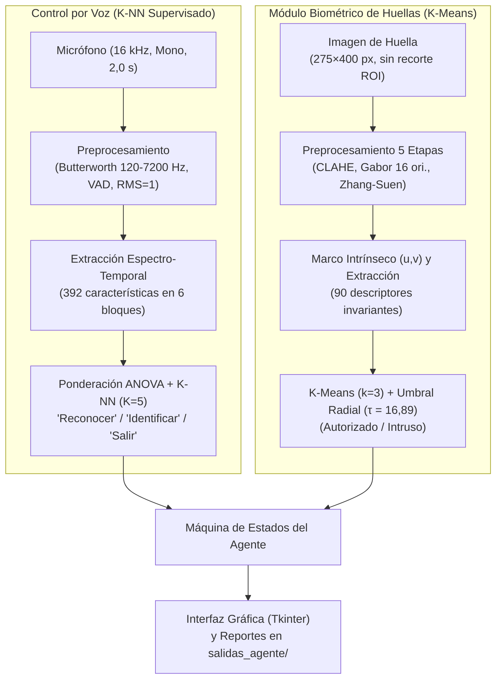
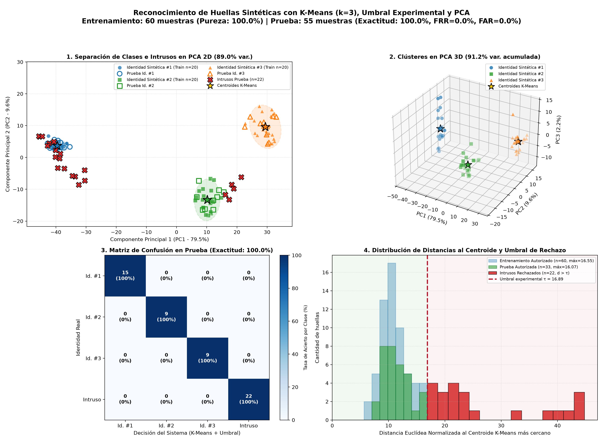
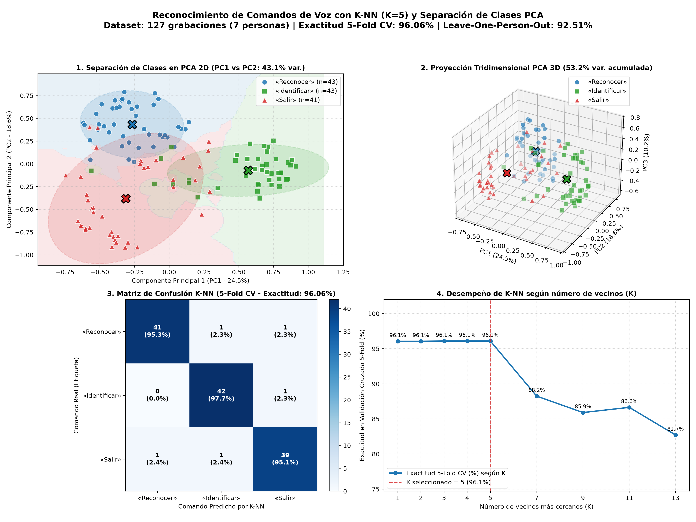

# Sistema de Control de Acceso Biométrico Multimodal (Huellas + Voz)

**Trabajo Final de Inteligencia Artificial I (2026)**  
**Ingeniería en Mecatrónica — Facultad de Ingeniería, Universidad Nacional de Cuyo (UNCUYO)**  
**Autor:** Julián Correa Villarreal (Legajo: 14110)  
**Cátedra:** Dra. Ing. Selva S. Rivera — Ing. Juan I. García  

---

## 📋 Descripción del Proyecto

Este proyecto implementa un **agente inteligente de control de acceso biométrico multimodal** que opera en tiempo real combinando:
1. **Visión Artificial:** Verificación e identificación de huellas dactilares sintéticas (sin recorte de ROI, conservando $275 \times 400\text{ px}$) mediante aprendizaje no supervisado (**K-Means**, $k=3$) sobre 90 descriptores invariantes a rototraslación y un umbral experimental de distancia euclídea ($\tau = 16,89$) para rechazo de intrusos.
2. **Reconocimiento de Voz:** Control por comandos hablados mediante aprendizaje supervisado (**K-NN**, $K=5$) sobre 392 características espectro-temporales (MFCC con normalización cepstral, $\Delta\text{MFCC}$, Log-Mel y ZCR en 6 bloques fonéticos ponderados por ANOVA).

El operador interactúa con la interfaz gráfica (GUI) a través del micrófono mediante tres comandos en secuencia estricta:
- **«Reconocer»**: Evalúa si la huella pertenece a una persona registrada (`AUTORIZADO`) o a un intruso (`NO AUTORIZADO`).
- **«Identificar»**: Si fue autorizada previamente, informa a cuál de las 3 identidades corresponde (`Identidad Sintética #1`, `#2` o `#3`).
- **«Salir»**: Finaliza de manera segura la ejecución del agente.

> 📄 **Informe Completo:** Podés consultar el marco teórico, la especificación REAS, las técnicas de procesamiento y el análisis experimental en [Trabajo Final Inteligencia Artificial I.pdf](./Trabajo%20Final%20Inteligencia%20Artificial%20I.pdf).

---

## 🧠 Arquitectura del Sistema



---

## 📊 Resultados Principales

| Subsistema | Algoritmo / Configuración | Dataset | Métrica Principal | Resultado |
| :--- | :--- | :--- | :--- | :---: |
| **Biometría de Huellas** | **K-Means ($k=3$)** + Umbral $\tau = 16,89$ | 60 entrenamiento / 55 prueba (33 autorizadas + 22 intrusas) | Pureza / Exactitud en Prueba | **100,0%** ($\text{FRR}=0\%$, $\text{FAR}=0\%$) |
| **Comandos de Voz** | **K-NN ($K=5$)** ponderado por distancia + ANOVA | 127 audios WAV (7 locutores, 3 comandos) | Exactitud 5-Fold CV / LOPO | **96,06%** / **92,51%** |





---

## 🛠️ Estructura del Repositorio

- `agente.py`: Aplicación principal con interfaz gráfica Tkinter, máquina de estados de seguridad, generador Anguli en vivo y exportación en `salidas_agente/`.
- `reconocimiento_huellas_kmeans.py`: Marco intrínseco $(u,v)$, extracción de 90 descriptores, entrenamiento K-Means ($k=3$), calibración del umbral $\tau = 16,89$ y gráficos PCA 2D/3D.
- `preprocesamiento.py`: Secuencia de 5 etapas de acondicionamiento dactilar sin recorte de ROI (CLAHE, Mediana+Gauss, banco de 16 filtros de Gabor, binarización adaptativa y esqueletizado de Zhang-Suen).
- `reconocimiento_voz_knn.py`: Filtrado Butterworth, recorte automático de voz activa (VAD), extracción de 392 descriptores (MFCC, CMN, $\Delta\text{MFCC}$, Log-Mel, ZCR), ponderación ANOVA y clasificador K-NN ($K=5$).
- `grabador_voz.py`: Utilidad interactiva para captura de comandos de voz a $16\text{ kHz}$ mono y actualización de `dataset_voz/metadata.csv`.
- `generador_anguli.py` y `generar_huella.sh`: Integración con Anguli (vía Wine) para generar nuevas impresiones sintéticas autorizadas (semilla `1604`) o intrusas en vivo.
- `distorsionador.py`: Generador de 9 distorsiones operativas (deformación elástica, presión morfológica, rotación, traslación, ruido y recortes parciales).
- `Trabajo Final Inteligencia Artificial I.pdf`: Informe técnico final del proyecto.

---

## 🚀 Instalación y Puesta en Marcha

### 1. Clonar el repositorio
```bash
git clone https://github.com/jcorreavi/IA1_ProyectoFinal.git
cd IA1_ProyectoFinal
```

### 2. Entorno virtual y dependencias
```bash
python3 -m venv .venv
source .venv/bin/activate
pip install -r requirements.txt
```

> **Requisitos de sistema en Linux (Ubuntu/Debian):** Para la interfaz gráfica, la captura de micrófono y la generación opcional en vivo con Anguli:
> ```bash
> sudo apt install python3-tk portaudio19-dev alsa-utils wine
> ```

### 3. Ejecutar el Agente Biométrico
Para lanzar la interfaz gráfica completa (carga los modelos preentrenados en caché en $\sim 5\text{ ms}$):
```bash
python3 agente.py
```

### 4. Ejecución de Módulos Individuales
- **Menú interactivo y evaluación del módulo de huellas (K-Means):**
  ```bash
  python3 reconocimiento_huellas_kmeans.py
  ```
- **Menú interactivo y evaluación del módulo de voz (K-NN):**
  ```bash
  python3 reconocimiento_voz_knn.py
  ```
- **Generar nuevas huellas de prueba por consola con Anguli:**
  ```bash
  ./generar_huella.sh --persona 1    # Genera huella autorizada (Persona 1, 2 o 3)
  ./generar_huella.sh --intrusa      # Genera huella intrusa con semilla aleatoria
  ```

---

## 🔗 Anexo y Dataset Externo
- **Dataset de huellas generado con Anguli:** [Acceso a la carpeta en Google Drive](https://drive.google.com/drive/folders/142IiwQwoeMKl8vDTO7QRR49mcHZEGSLU?usp=sharing)
- Las librerías y versiones exactas utilizadas se detallan en `requirements.txt`.
